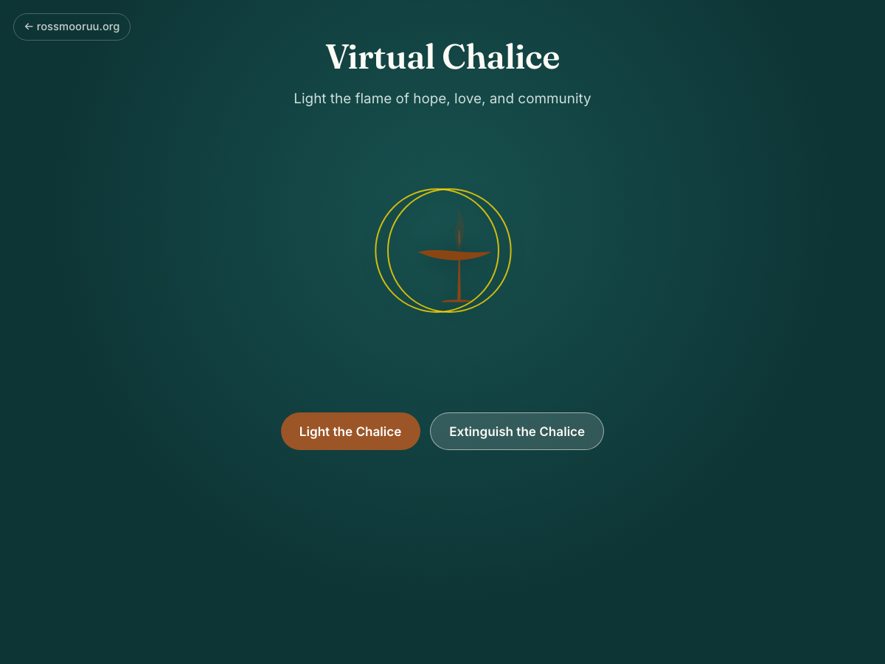

# Virtual Unitarian Universalist Chalice

A beautiful web application that displays a virtual Unitarian Universalist chalice with the ability to light and extinguish an animated flame. This interactive experience brings the sacred UU ritual of chalice lighting to the digital world.



## Features

- **Interactive Chalice**: Click to light or extinguish the sacred flame
- **Animated Flame**: Realistic flickering flame animation when lit
- **Sacred Symbolism**: Features the traditional UU chalice with interlocking circles
- **Responsive Design**: Works beautifully on desktop and mobile devices
- **Inspiring Message**: Displays a meaningful quote when the chalice is lit

## Getting Started

### Prerequisites

- Node.js (version 16 or higher)
- npm or yarn

### Installation

1. Clone the repository or download the source code
2. Install dependencies:

   ```bash
   npm install
   ```

### Development

To start the development server:

```bash
npm run dev
```

The application will be available at `http://localhost:5173` (or another port if 5173 is in use).

### Building for Production

To build the application for production:

```bash
npm run build
```

The built files will be in the `dist` directory.

### Preview Production Build

To preview the production build locally:

```bash
npm run preview
```

## Technology Stack

- **React 18** with TypeScript for robust component development
- **Vite** for fast development and optimized builds
- **CSS3** with custom animations for the flame effect
- **SVG** for crisp, scalable chalice graphics

## About the Unitarian Universalist Chalice

The flaming chalice has been a symbol of Unitarian Universalism for decades. It represents the light of reason, the warmth of community, and the flame of hope. This virtual chalice brings that sacred ritual into the digital age, allowing UU communities to light their chalice together, even when apart.

## Usage

1. **Light the Chalice**: Click the "Light the Chalice" button to ignite the flame
2. **Read the Message**: When lit, a meaningful quote appears below the chalice
3. **Extinguish**: Click "Extinguish the Chalice" to put out the flame

Perfect for:

- Online UU services and gatherings
- Personal spiritual practice
- Educational purposes about UU traditions
- Meditation and reflection

## Contributing

Feel free to submit issues and enhancement requests!

## License

This project is open source and available under the [MIT License](LICENSE).
